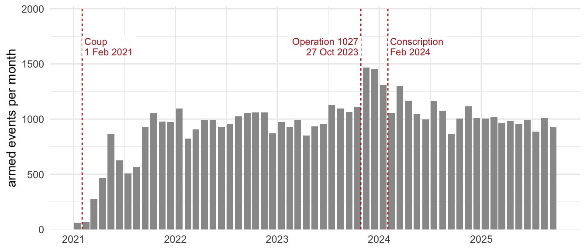
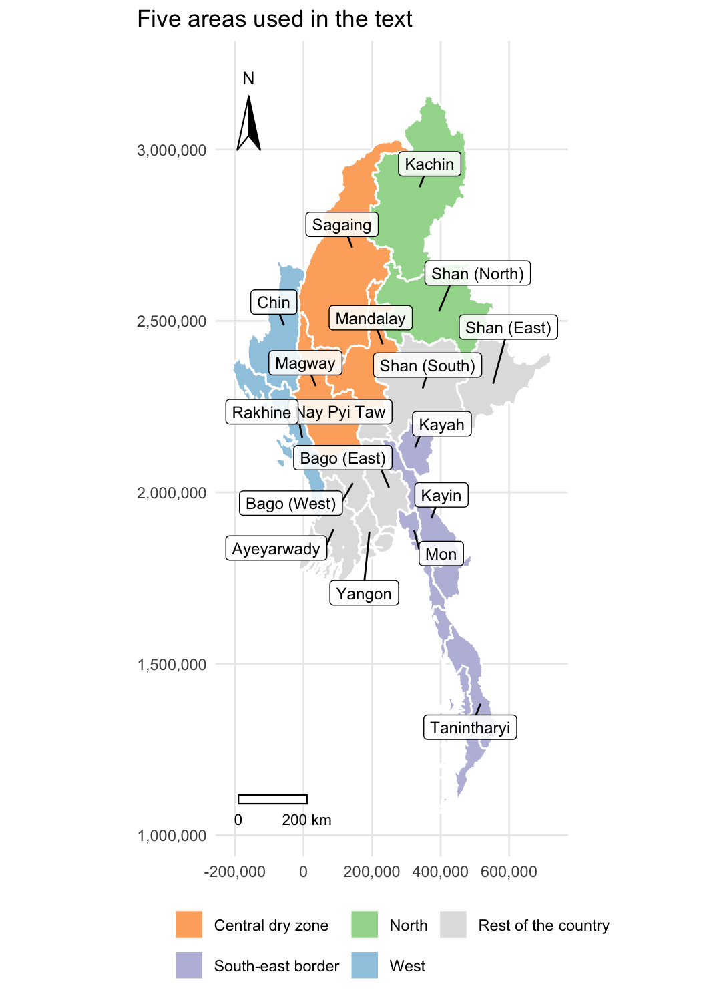
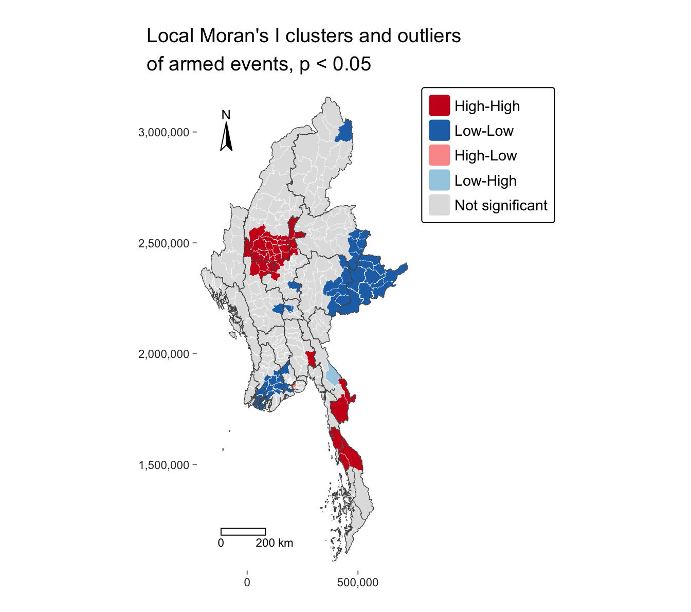
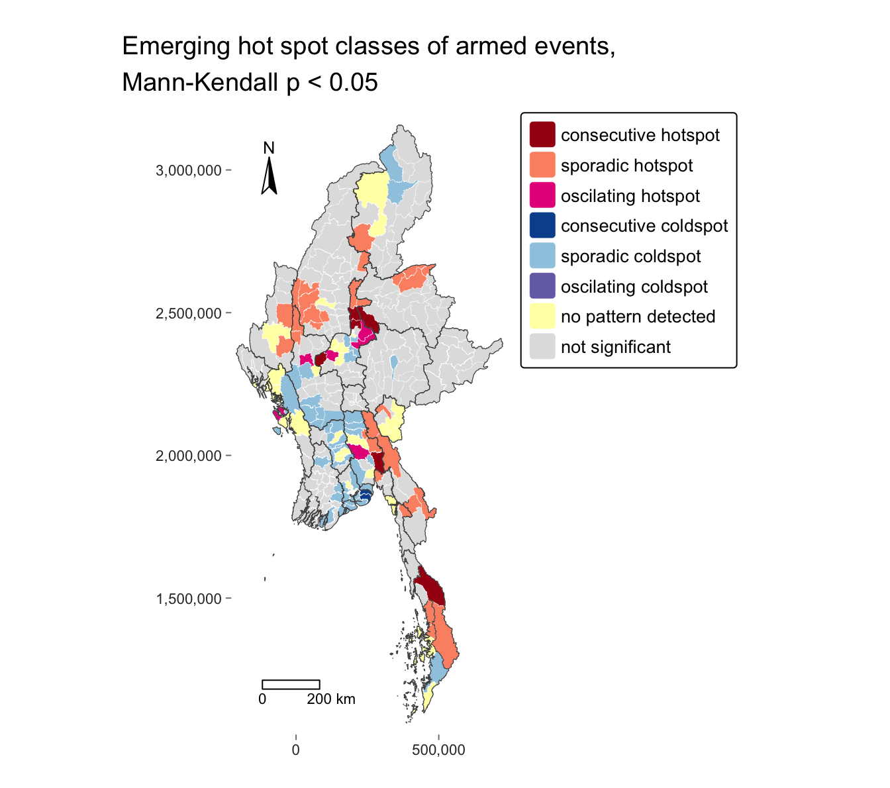
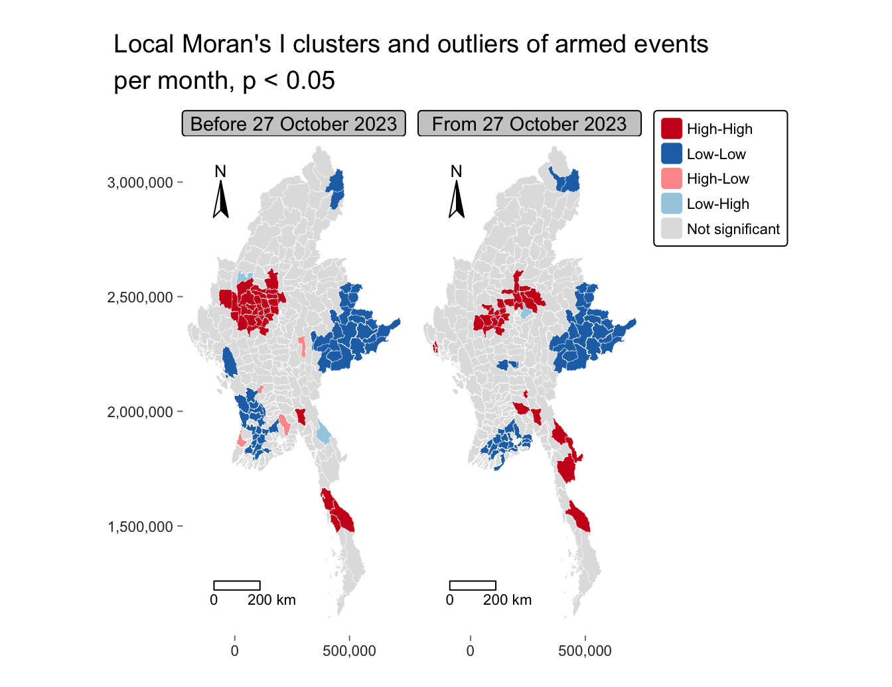
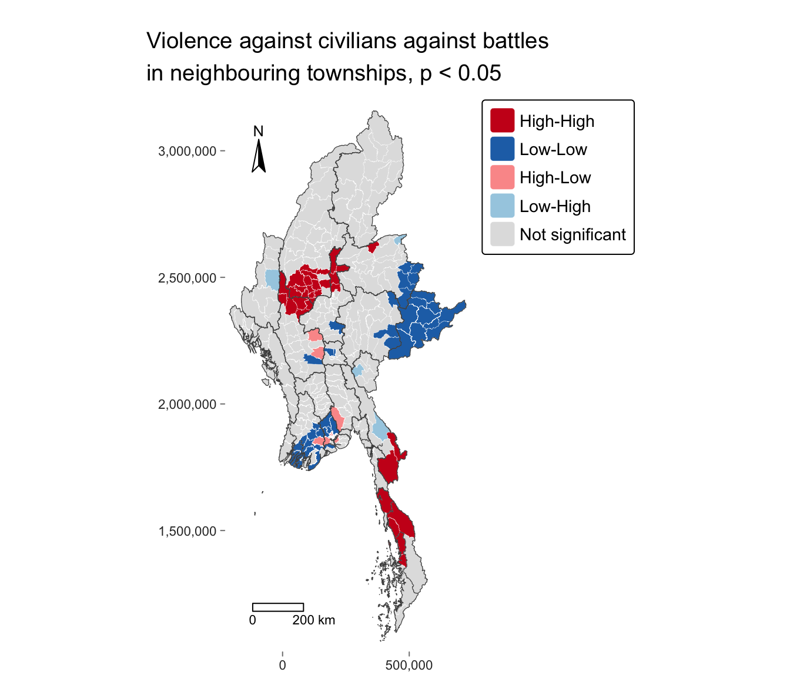

## Contents

1. Research question and objectives
2. Study area and data
3. Analytical approach
4. Armed conflict clusters in the central dry zone
5. Late hot spots are around Mandalay
6. The clusters spread after Operation 1027
7. Violence against civilians next to few battles in Yangon
8. Limitations
9. Implications for peace-building
10. Key findings

## Research question and objectives

Where did armed conflict concentrate among Myanmar's 330 townships after the February 2021 coup,
and how did its hot spots change to September 2025?

::: {.columns}
::: {.column width="55%"}
**Research questions**

- **RQ1.** Which townships belong to clusters of high or low counts, and which are outliers?
- **RQ2.** Where did hot spots emerge, persist or fade?
- **RQ3.** Do battles, explosions and violence against civilians concentrate in the same places?
- **RQ4.** Did the clusters change after Operation 1027 began on 27 October 2023?
:::
::: {.column width="45%"}

Armed events per month, with the coup, Operation 1027 and conscription marked
:::
:::

## Study area and data {.smaller}

::: {.columns}
::: {.column width="62%"}
**330 townships, 1 January 2021 to 30 September 2025**

- **ACLED** (Armed Conflict Location and Event Data Project): 87,109 records, of which 54,004 armed
  events (battles 21,121; explosions and remote violence 22,925; violence against civilians 9,958)
- **53,907 events are analysed**, after 4 events at sea and 93 with geo-precision code 3 are dropped
- **MIMU** township boundaries, version 9.4; **OCHA** population projection, 2023

**Data quality**

- Events are assigned by **coordinates**. Of 12 events outside every township, 8 are assigned to
  the nearest township and 4 at sea are dropped
- **45%** of the analysed events have geo-precision code 2 and are placed at a nearby town
- **Three island townships** are linked to their nearest township
- **Eight townships** with no armed event keep a count of 0
:::
::: {.column width="38%"}
{height=560}
:::
:::

## Analytical approach

::: {.columns}
::: {.column width="52%"}
**Methods**

- **Global:** Moran's I and Geary's C on contiguity weights, 999 permutations; Getis-Ord Global
  G on a 185 km distance band
- **Local:** local Moran's I (classes split at the median), local Geary's c, Gi and Gi\*
- **Emerging hot spots:** Gi\* in each of 19 quarters, Mann-Kendall trend test, classes at
  p < 0.05
- **Value added:** local Moran's I before and after 27 October 2023; bivariate local Moran's I
:::
::: {.column width="48%"}
**Checks on the choices**

- **Weights:** with k-nearest neighbours, the local class differs from the contiguity class for 14%
  ($k = 6$) and 15% ($k = 8$) of townships
- **Multiple comparisons:** 43 of 84 High-High and Low-Low townships stay significant after the
  false discovery rate correction
- **Serial correlation:** 28 of 151 significant trends lose significance after the Hamed and Rao
  correction
- **Time bin:** with monthly bins, 1 of 330 townships moves between a hot and a cold spot class
:::
:::

## Armed conflict clusters in the central dry zone

::: {.columns}
::: {.column width="46%"}
{height=520}
:::
::: {.column width="54%"}
- **Global Moran's I is 0.49** (p ≤ 0.001): neighbouring townships have similar counts. For each
  event type, Moran's I is 0.45 to 0.48
- **35 High-High townships hold 32% of all armed events.** 29 of them are in one group in Sagaing,
  Magway and Mandalay Regions, from Shwebo and Monywa south to Pakokku
- Little fighting was recorded in this area in the decades before 2021 (Su Mon, 2024)
- **Local Moran's I and Gi\*:** every High-High township is a Gi\* hot spot, and 46 of the 49
  Low-Low townships are Gi\* cold spots
- **46 of the 49 Low-Low townships** are in Shan, the Ayeyarwady delta, Yangon and Nay Pyi Taw
:::
:::

## Late hot spots are around Mandalay

::: {.columns}
::: {.column width="46%"}
{height=520}
:::
::: {.column width="54%"}
- **No township is a persistent or intensifying hot spot**
- **12 consecutive and oscillating hot spots** are hot in the last quarters of the period. Six of
  them are in Mandalay Region
- The trend filter at p < 0.05 **removes 20 of the 35 High-High townships**. In all 20, Gi\* is higher
  in the middle quarters than at the start and the end, and the Mann-Kendall test detects only
  monotonic trends
- **13 persistent cold spots**, in Shan and the Ayeyarwady delta, are removed by the same filter
:::
:::

## The clusters spread after Operation 1027

::: {.columns}
::: {.column width="52%"}

:::
::: {.column width="48%"}
- **Armed events per month rose from 854 to 1,080**; global Moran's I fell from **0.53 to 0.37**
- **10 townships are High-High only after 27 October 2023**: north of Mandalay, northern Shan,
  northern Rakhine, the Thai border in Kayin, and Bago (East)
- **18 of the 33** High-High townships before 27 October 2023 stayed High-High
- **Cohen's kappa is 0.45**: 76% of townships keep their class, against 57% by chance
:::
:::

## Violence against civilians next to few battles in Yangon

::: {.columns}
::: {.column width="46%"}
{height=520}
:::
::: {.column width="54%"}
Bivariate local Moran's I links violence against civilians in a township to battles in its
neighbours.

- **32 High-High townships**: 24 in the central dry zone, 5 in Tanintharyi, 2 in Kayin and 1 in
  northern Shan
- **19 High-Low townships**, 15 in **Yangon**: violence against civilians above the median, next to
  battle counts below the median
- The map of violence against civilians alone has **no High-High township in Yangon**
- The Yangon pattern is consistent with the targeted killings and detentions that Su Mon (2024)
  describes
:::
:::

## Limitations

- **Reported events only.** ACLED records events that its sources report, so cold spots and zero
  counts may partly reflect limited access
- **Location precision.** 45% of the events are placed at a nearby town, so the clusters may
  depend in part on the locations of those towns
- **Counts as the variable.** Rates per 100,000 people also cluster (Moran's I 0.67 for the log
  rate), so population size may account for only part of the clustering
- **Multiple comparisons.** 43 of the 84 High-High and Low-Low townships remain significant after
  the false discovery rate correction. The 330 Mann-Kendall tests are not corrected
- **Serial correlation.** The Gi\* series of 77% of townships are autocorrelated, and the
  Mann-Kendall test assumes no serial correlation
- **One break date.** Operation 1027 and conscription from February 2024 fall in the same period,
  so the comparison combines their effects

## Implications for peace-building

The maps show where ACLED recorded events. They give no evidence on causes or on the needs of the
population.

- **Protection next to battles.** Su Mon (2024) describes the military turning "to the closest
  civilian population center to detain, torture, and kill" after losses. Protection of civilians and
  humanitarian access may be priorities in the bivariate High-High townships
- **Monitoring in Yangon.** Monitoring of detentions and targeted killings may be relevant in the
  15 High-Low townships
- **Late hot spots first.** The consecutive and oscillating hot spots around Mandalay and in
  Nawnghkio are hot at the end of the period, so they may be the first places for monitoring

- **Cold spots and reporting.** 3 of the 13 persistent cold spots before the filter are in Matman
  District, governed by the United Wa State Army since its ceasefire of May 1989. Reporting there
  may need verification before these townships are treated as quiet

## Key findings

- **RQ1, clusters and outliers.** 35 High-High townships hold 32% of armed events, 29 of them in
  one group in the central dry zone; the two outliers are Hlaingbwe and Thanlyin
- **RQ2, emergence and change.** No persistent or intensifying hot spot; 6 of the 12 hot spots at
  the end of the period are in Mandalay Region, and Gi\* in 20 High-High townships rose and fell
- **RQ3, three kinds of violence.** The central dry zone is High-High for all three; 15 Yangon
  townships have violence against civilians next to few battles
- **RQ4, after Operation 1027.** Events per month rose by 26%, and the clusters spread to northern
  Shan, northern Rakhine and the Thai border
- **Implications and limits.** Protection next to battles, monitoring in Yangon and around
  Mandalay; reported events only, 45% of locations approximate

The technical report contains the full analysis and code.

**Key references.** Anselin (1995); Getis and Ord (1992); Mack and Kam (2018); Boschan and Roman
(2024); Su Mon (2024).
